  

## 🌐 Socials:

# 💻 Tech Stack:
 

  
 
 
 
 
 
 
 
 

### 🚀 Featured Projects:

- **Local AI Search Engine** — Still under development...

- **Java Course Manager** — Console-based Java application for adding, viewing, searching, editing, and removing courses. Built using object-oriented programming, ArrayList, Scanner, loops, and duplicate-course prevention. Currently expanding it with assignment and grade tracking.

- **C++ Dungeon Battle Game** — Console-based turn-based battle game with attack, heal, and defend mechanics. Includes random damage, limited healing, difficulty levels, replay functionality, and input validation.

### 💼 Experience & Competitions

**Full-Stack Developer | Stripe Workplace Challenge (Dual Enrollment @ QCC)** 
* **Collaborated** in a team of 5 to architect and build a fully functional business web application.
* **Integrated Stripe API** services to handle secure, rapid end-to-end customer transactions.
* **Presented** the final product and business website to a team of 10, securing **2nd Place** out of the competition and a **$500 cash prize**.

---

  
  

